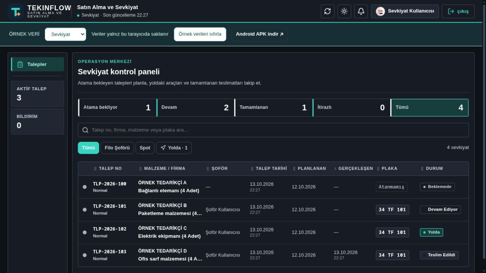
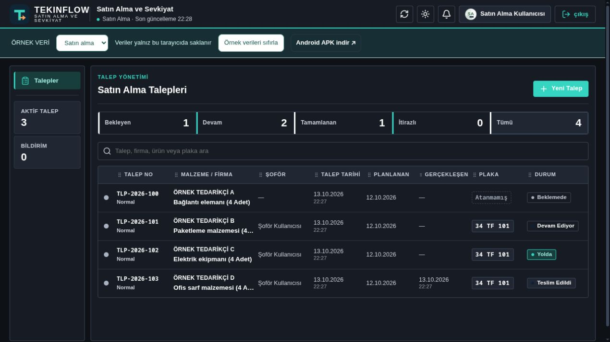
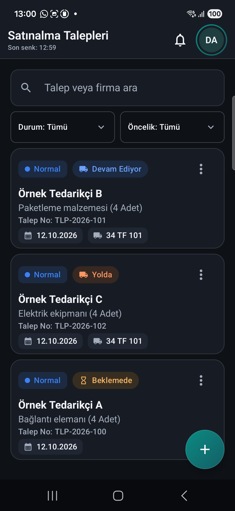
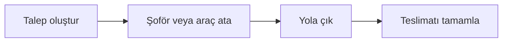

<p align="center"></p>

# TekinFlow

**Satın alma, sevkiyat ve teslimat için açık kaynak operasyon uygulaması.**

Tek geliştirici tarafından geliştirilen TekinFlow; satın alma ekibi, sevkiyat sorumlusu ve şoförün aynı talebi farklı rollerde takip etmesini sağlar. Kotlin/Compose Android uygulaması, React web paneli ve Kotlin/Ktor backend kaynakları bu depoda yer alır.

[Webde dene](https://tekinflow.muhammet-tekin.dev) · [Android APK indir](https://github.com/Tekin4124/tekinflow/releases/latest/download/TekinFlow.apk) · [Kurulum](#web-panelini-çalıştır) · [Katkıda bulun](CONTRIBUTING.md) · [MIT](LICENSE)

## Ekran görüntüleri

Canlı web panelleri ve Android ekranı; tüm kayıtlar hayalidir.





<details><summary>Android görünümü</summary>



</details>


## Neler yapar?

| Çalışma alanı | İşlev |
| --- | --- |
| Satın alma | Çok kalemli talep oluşturma; malzeme, birim, tedarikçi, tarih ve öncelik takibi |
| Sevkiyat | Filo şoförü veya spot araç atama, plaka ve sevkiyat durumu yönetimi |
| Şoför | Atanan işleri görme, yola çıkma, teslim alan kişiyle teslimi tamamlama |
| Yönetim | Kullanıcı/rol yönetimi ve işlem geçmişini inceleme |

Arama ve filtreler, uygulama içi bildirimler, koyu/açık tema ve Android yerel önbelleği bulunur. Genel iş akışı:



## Hemen kullan

[Releases](https://github.com/Tekin4124/tekinflow/releases/latest) sayfasından **TekinFlow.apk** dosyasını indir. Android 8.0 ve üzeri gerekir.

Bir rol seçerek başlayabilirsin; hesap veya sunucu gerekmez. Satın alma rolünde talep oluştur, profilden çıkış yapıp sevkiyat rolüne geç ve **Şoför Kullanıcısı** ata. Şoför rolünde aynı işi yola çıkarıp teslim et. Android örnekleri aynı uygulama süreci boyunca korunur.

Bu depo bir ürünün açık kaynak kodudur. Hazır APK ve web başlangıç kurulumu, gerçek kurum verisi taşımadan iş akışını denemek için **örnek veri modu** kullanır. Bu moddaki rol seçimi üretim giriş sistemi değildir. Gerçek backend entegrasyonu aşağıda açıklanmıştır.

## Web panelini çalıştır

Node.js 24 veya üzeri:

```sh
git clone https://github.com/Tekin4124/tekinflow.git
cd tekinflow/web
npm ci
npm run dev
```

[localhost:5173](http://localhost:5173) adresini aç. Rol değiştirerek talebin tüm aşamalarını takip edebilirsin. Veriler bu tarayıcının yerel deposunda saklanır; **Örnek verileri sıfırla** başlangıç kayıtlarına döner.

```sh
npm test
npm run build
npm run preview
```

`web/dist/` statik dosyalardan oluşur; örnek veri modunda ayrı bir API sunucusu istemez. Android ve web örnek kayıtları birbirinden bağımsızdır.

## Android'i derle

JDK 17 ve Android SDK 34 ile proje kökünde:

```sh
./gradlew :app:testDemoDebugUnitTest :app:assembleDemoOptimized
```

APK: `mobile-android/build/outputs/apk/demo/optimized/app-demo-optimized.apk`.

Bu çeşit R8 optimizasyonu kullanır ve hata ayıklaması kapalıdır. Denemek için yerel debug anahtarıyla imzalanır; özel imza anahtarı repoya eklenmez. Kendi üretim dağıtımın için kendi release imzanı yapılandır. Hata ayıklamak için `:app:assembleDemoDebug` çalıştırabilirsin. `demo` derleme çeşidi ve `com.tekinflow.demo` paket adı teknik uyumluluk için korunmuştur.

## Kendi backend'ine entegre et

`backend/` dizininde Ktor API, PostgreSQL şeması ve Flyway migration'ları vardır. Backend için JDK 21 gerekir. `backend/server.env.example` dosyasındaki değişkenleri kendi ortamında tanımla; şablon otomatik yüklenmez.

Gerekli yapılandırma: PostgreSQL bağlantısı, veritabanı kullanıcı/parolası, rastgele JWT sırrı, ilk yönetici parolası ve 32 baytlık TOTP şifreleme anahtarı. Anahtar örneği `openssl rand -base64 32` ile üretilebilir. Firebase sunucu bildirimi isteğe bağlıdır ve kendi hesabını gerektirir.

```sh
cd backend
./gradlew test build
./gradlew run
```

Hazır istemciler yerel veri adaptörüne bağlanır. Canlı kullanım için Android `NetworkModule`/`LocalDemoApi` bağlantısını gerçek API implementasyonuyla değiştir, uygun HTTPS ağ politikasını ve giriş akışını yapılandır; webde `web/src/api.ts` yerine sunucu adaptörünü kullan. Hazır Android APK'da INTERNET izni ve Firebase istemcisi bulunmaz. Yalnız sunucu adresini değiştirmek canlı entegrasyon sağlamaz.

Backend; JWT, rol kontrolü, rate limit, işlem geçmişi, idempotent tekrarlar ve TOTP şifreleme içerir. Mevcut bir veritabanını taşımadan önce migration'ları yedek üzerinde dene; şifreleme anahtarını kaybedersen eski TOTP kayıtlarına erişemezsin.

## Kaynak yapısı

```text
mobile-android/  Compose ekranlar, Room/SQLCipher önbelleği, yerel API adaptörü
web/             React + TypeScript panel, yerel veri adaptörü, web testleri
backend/         Ktor + PostgreSQL API, migration'lar ve backend testleri
branding/        TekinFlow logo kaynakları
.github/         Android, web ve backend build/test akışları
```

## Doğrulama ve bilinen sınırlar

- 73 Android, 5 web ve 15 backend testi yerel kontrolde geçti; GitHub Actions da bu katmanları doğrular.
- Android örnek verileri süreç yeniden başladığında başlangıç durumuna döner; kalıcı hesap/veri servisi değildir.
- Web örnek formlarına uydurma bilgiler gir. Parola alanları gerçek hesap oluşturmaz; parola saklanmaz.
- Backend talep listesi son 500 kayıtla sınırlıdır; büyük kurulumlar için sunucu taraflı sayfalama/arama geliştirilmelidir.
- Transaction testleri H2 kullanır; gerçek PostgreSQL migration'ı ve canlı servis entegrasyonu ayrıca test edilmelidir.

## Veri ve lisans

Paylaşılan kayıtlar hayalidir. Bu kaynakta kurum logosu, gerçek çalışan/müşteri kayıtları, üretim adresleri, veri yedekleri veya özel depoların Git geçmişi bulunmaz. Güvenlik bildirimi için [SECURITY.md](SECURITY.md), katkı için [CONTRIBUTING.md](CONTRIBUTING.md) dosyasına bak.

**MIT lisansı**: kodu inceleyebilir, değiştirebilir ve kendi projelerinde kullanabilirsin. Üçüncü taraf bağımlılıkları kendi lisanslarına tabidir.

Geliştirici: [Tekin4124](https://github.com/Tekin4124)
